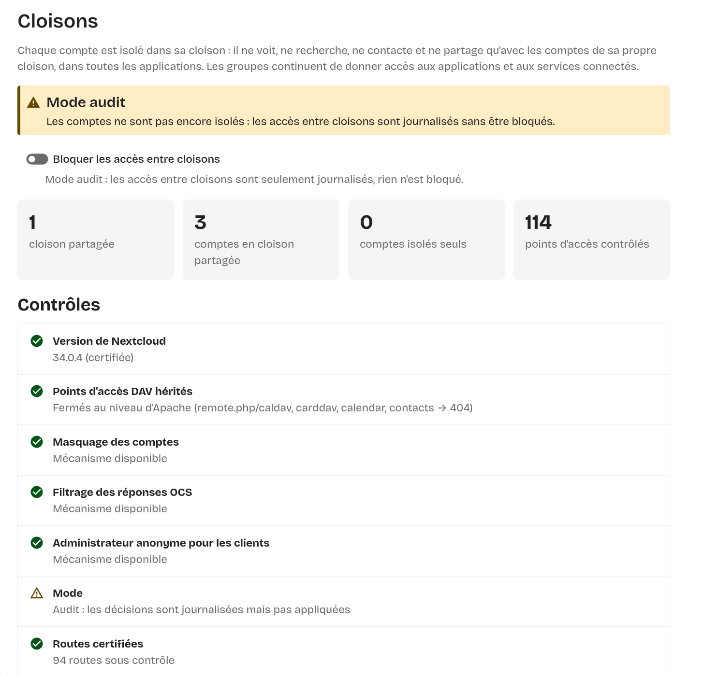

# Cloisons — une instance privée pour chacun, sur un Nextcloud mutualisé

**Cloisons** est une application Nextcloud qui isole les comptes d'une même
instance les uns des autres. Chaque personne accueillie a **la même isolation
que si elle disposait de sa propre instance privée** : elle ne voit, ne
recherche, ne contacte, n'invite et ne partage qu'avec les comptes de sa
propre cloison, et cela dans **toutes les applications certifiées** (Fichiers,
Talk, Agenda, Contacts, Équipes, Formulaires, Text, ONLYOFFICE, LibreSign…).

Elle s'adresse aux hébergeurs, associations, collectivités, informaticiens de
proximité ou familles qui veulent accueillir plusieurs personnes ou structures
sur **une seule** infrastructure Nextcloud, sans multiplier les instances, et
sans que les comptes accueillis puissent se découvrir entre eux.

- Aucun fichier du cœur de Nextcloud n'est modifié : uniquement des points
  d'extension publics (événements, middleware, greffon WebDAV).
- Aucune perte de fonction à l'intérieur d'une cloison.
- Un compte caché se comporte **exactement** comme un compte inexistant : pas de
  nom, pas d'avatar, pas d'« oracle » (réponse différente qui trahirait son
  existence).
- Mode **audit** (journalise sans bloquer) pour valider avant d'appliquer.
- Écran d'administration intégré au thème Nextcloud (clair/sombre, mobile).

> Langue : l'application et sa documentation sont en français.

<p align="center">
  
  <br>
  <em>Paramètres d'administration → Cloisons : mode, compteurs et contrôles de santé.</em>
</p>

---

## Sommaire

1. [Le principe en une minute](#le-principe-en-une-minute)
2. [Ce qui est cloisonné](#ce-qui-est-cloisonné)
3. [Compatibilité](#compatibilité)
4. [Installation rapide](#installation-rapide)
5. [Commandes](#commandes)
6. [Accueillir une nouvelle personne](#accueillir-une-nouvelle-personne)
7. [Documentation détaillée](#documentation-détaillée)
8. [Limites à connaître](#limites-à-connaître)
9. [Licence](#licence)

---

## Le principe en une minute

Nextcloud mélange deux notions dans les **groupes** : ils donnent accès à des
applications (ou à des services via OIDC), **et** ils rendent visibles les
comptes entre eux. Cloisons sépare ces deux rôles :

| Notion | Rôle |
|---|---|
| **Groupe** | Droit d'accès uniquement : ouvre une application (Office, Talk…) ou un service. Inchangé. |
| **Cloison** | Visibilité : deux comptes ne se voient que s'ils sont dans la même cloison. |

- Par défaut, **chaque compte est seul dans sa cloison**. Un compte oublié est
  donc isolé, jamais exposé.
- Une **cloison partagée** (par exemple « famille » ou « asso-velo ») regroupe
  des comptes qui doivent collaborer. Elle a son propre groupe Nextcloud
  `cloison-<id>`, tenu à jour automatiquement : c'est lui qu'on utilise pour
  partager au sein de la cloison.

```
             Instance Nextcloud mutualisée
 ┌───────────────────────────┬──────────────┬──────────────┐
 │ Cloison « famille »       │ Cloison      │ Cloison      │
 │  anne ⇄ paul (partages,   │  client-a    │  client-b    │
 │  Talk, agendas…)          │  (seul)      │  (seul)      │
 └───────────────────────────┴──────────────┴──────────────┘
   Tous dans les groupes « Office » et « Talk » : chacun utilise
   les applications, personne ne voit les autres cloisons.
```

## Ce qui est cloisonné

| Domaine | Comportement pour un compte d'une autre cloison |
|---|---|
| Recherche, autocomplétion, mentions, menu des contacts, recherche globale | Absent des résultats |
| Avatar, profil, carte de visite, statut, absence | Réponse d'un compte inexistant |
| Partages (compte, groupe mixte, équipe, e-mail d'un compte, fédération vers ce serveur) | Refusés côté serveur, quelle que soit l'application d'origine |
| Talk | Conversations, ajout de participants, mentions, conversations ouvertes |
| Agenda / CardDAV / WebDAV | Recherche de principaux, carnet système, partages, délégations, disponibilités ; invitations envoyées par e-mail comme vers une adresse externe |
| Équipes (Circles) | Recherche, ajout de membres, adhésion, liens d'invitation |
| Formulaires, Text, ONLYOFFICE, LibreSign, Bookmarks, Activité, Tableau de bord | Filtrés (voir la [table de certification](cloisons/lib/Service/Rules.php)) |
| Liens publics d'une autre cloison ouverts par un compte **connecté** | Refusés (sauf simple téléchargement), comme si le lien n'existait pas ; accessibles en navigation privée |
| Activité générée par un administrateur d'une autre cloison | Anonymisée |

Le détail des mécanismes est dans [docs/FONCTIONNEMENT.md](docs/FONCTIONNEMENT.md).

## Compatibilité

| Nextcloud | Statut |
|---|---|
| 34.0.x | **Certifié par la batterie de tests complète** (banc, 0 fuite, 0 oracle, 0 régression) |
| 35.0.x (35.0.2) | Certifié par revue de code des versions 35.0.2 et des dernières versions des applications ; campagne de tests à rejouer avant mise en production |

PHP 8.2 ou plus récent. Testé sur MariaDB ; l'application n'utilise que le
constructeur de requêtes de Nextcloud et devrait fonctionner sur PostgreSQL et
SQLite, sans que ce soit encore testé. Les versions exactes des applications certifiées sont
listées dans [docs/CERTIFICATION.md](docs/CERTIFICATION.md) et vérifiées en
continu par `occ cloisons:status`.

## Installation rapide

```bash
# 1. Copier l'application (dossier cloisons/ de ce dépôt)
sudo cp -r cloisons /var/www/nextcloud/apps/
sudo chown -R www-data:www-data /var/www/nextcloud/apps/cloisons

# 2. Activer (démarre en mode audit : rien n'est bloqué)
OCC="sudo -u www-data php /var/www/nextcloud/occ"
$OCC app:enable cloisons
```

3. **Fermer les anciens points d'accès DAV** (obligatoire, voir
   [docs/INSTALLATION.md](docs/INSTALLATION.md)) — exemple Apache :

   ```apache
   RedirectMatch 404 "^/remote\.php/(caldav|carddav|calendar|contacts)(/|$)"
   ```

   puis déclarer que c'est fait :

   ```bash
   $OCC config:app:set cloisons legacy_dav_blocked --value=yes --lazy
   ```

4. Vérifier, créer les cloisons partagées, observer le journal, puis appliquer :

   ```bash
   $OCC cloisons:selftest
   $OCC cloisons:zone create famille "Famille"
   $OCC cloisons:zone add famille anne
   $OCC cloisons:zone add famille paul
   $OCC cloisons:scan            # aucun lien existant entre cloisons ?
   $OCC cloisons:mode enforce
   ```

Installation détaillée, réglages recommandés et serveur nginx :
[docs/INSTALLATION.md](docs/INSTALLATION.md).

## Commandes

| Commande | Effet |
|---|---|
| `occ cloisons:status [--output=json]` | État de santé ; code retour 1 si un contrôle échoue (supervision) |
| `occ cloisons:selftest` | Autotest en lecture seule, à lancer après chaque mise à jour |
| `occ cloisons:mode [audit\|enforce]` | Affiche ou change le mode |
| `occ cloisons:zone list` | Cloisons partagées et leurs membres |
| `occ cloisons:zone create <id> "<Nom>"` | Crée une cloison partagée (id : `a-z0-9_-`) |
| `occ cloisons:zone rename <id> "<Nom>"` | Renomme |
| `occ cloisons:zone delete <id>` | Supprime (ses membres redeviennent seuls) |
| `occ cloisons:zone add <id> <compte>` | Ajoute un compte à une cloison partagée |
| `occ cloisons:zone remove <id> <compte>` | Retire un compte (il redevient seul) |
| `occ cloisons:zone show <compte>` | Cloison d'un compte |
| `occ cloisons:scan [--output=json]` | Liens existants entre cloisons (lecture seule) |
| `occ cloisons:repair-activity [--dry-run]` | Anonymise rétroactivement l'administrateur dans les activités |

Référence complète : [docs/COMMANDES.md](docs/COMMANDES.md). Tout est aussi
disponible dans *Paramètres d'administration → Cloisons*.

## Accueillir une nouvelle personne

1. Créer son compte (interface, `occ user:add`, ou votre outil de gestion).
   Il est **isolé dès sa création**, sans autre action.
2. L'ajouter aux **groupes d'accès** des applications qu'elle doit utiliser.
3. Avant le **premier** ajout d'une personne extérieure à un groupe d'accès,
   `occ cloisons:scan` ne doit rien signaler : un partage, une conversation Talk
   ou un agenda déjà ouvert à ce groupe lui deviendrait accessible.
4. S'il s'agit d'une structure de plusieurs comptes qui collaborent : créer une
   cloison partagée et y ajouter ses comptes.

## Documentation détaillée

| Document | Contenu |
|---|---|
| [docs/FONCTIONNEMENT.md](docs/FONCTIONNEMENT.md) | Architecture, compte fantôme, liens publics, groupes de cloison, modes |
| [docs/INSTALLATION.md](docs/INSTALLATION.md) | Prérequis, installation, Apache/nginx, réglages natifs, compilation de l'interface |
| [docs/COMMANDES.md](docs/COMMANDES.md) | Toutes les commandes `occ` avec exemples |
| [docs/EXPLOITATION.md](docs/EXPLOITATION.md) | Mises à jour, supervision, journal, désactivation d'urgence |
| [docs/SECURITE.md](docs/SECURITE.md) | Modèle de menace, garanties, limites |
| [docs/CERTIFICATION.md](docs/CERTIFICATION.md) | Versions certifiées et méthode pour certifier une nouvelle version |
| [docs/TESTS.md](docs/TESTS.md) | Banc Docker et batteries de tests de fuite, d'oracle et de régression |

## Limites à connaître

- Les **administrateurs** Nextcloud gardent leurs pouvoirs (gestion des comptes,
  journaux, base de données) : la confiance envers l'hébergeur reste nécessaire,
  comme pour toute instance hébergée.
- Seules les applications **certifiées** sont couvertes. Une application non
  listée ou d'une version non certifiée est signalée par `occ cloisons:status`
  et doit être testée avant d'être ouverte aux comptes accueillis.
- Les anciens points d'accès DAV doivent être fermés **au niveau du serveur
  web** : l'application ne peut pas les filtrer.

Voir [docs/SECURITE.md](docs/SECURITE.md). Pour signaler une faille :
[SECURITY.md](SECURITY.md).

## Licence

[AGPL-3.0-or-later](LICENSE) — © Azure Informatique.
